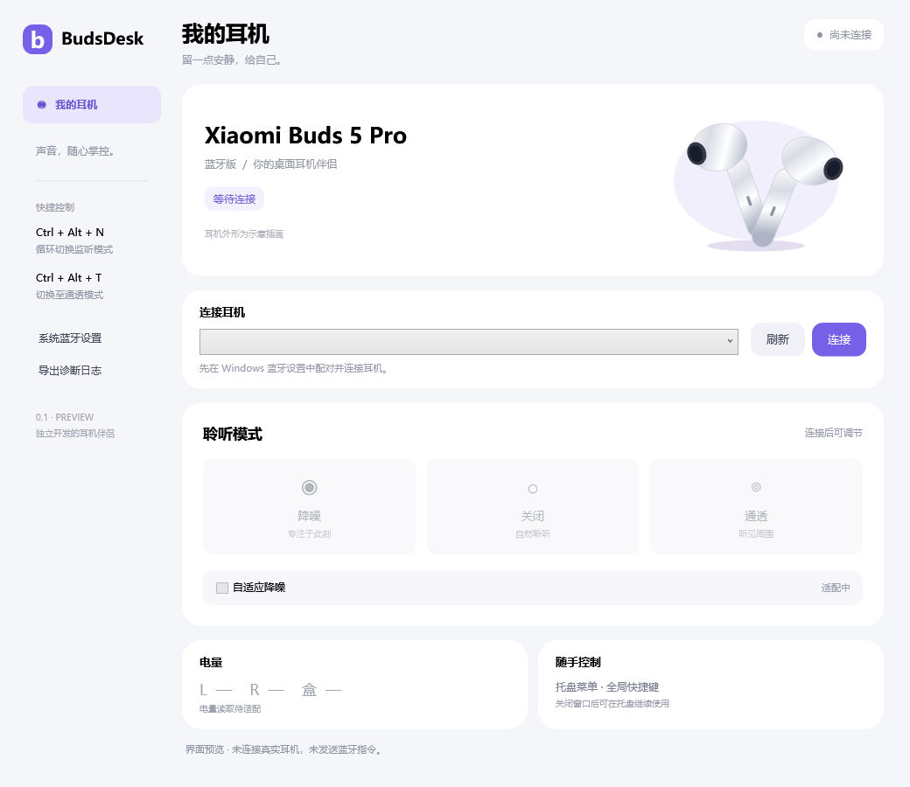

# BudsDesk

小米 **Xiaomi Buds 5 Pro 蓝牙版**的 Windows 桌面伴侣。首个预览版：v0.1.0。



## 功能

- 降噪、关闭、通透三种监听模式切换。
- 读取耳机实际模式，切换后再次读取并确认。
- 托盘菜单和全局快捷键。
- 可手动导出本地诊断日志。

已完成实机握手和状态读取，使用者已确认模式切换成功。38 项协议与结构检查通过。

**自适应降噪、电量、EQ、手势尚未实现。** 当前版本适配目标是 Xiaomi Buds 5 Pro 蓝牙版；未验证其他型号或 Wi-Fi 版。

## 下载与使用

在本仓库的 **Releases** 页面下载 `BudsDesk-v0.1.0-win-x64.zip`，解压后运行 `BudsDesk.exe`。

1. 在 Windows 蓝牙设置中配对并连接耳机。
2. 打开 BudsDesk，选择耳机，点击“连接”。
3. 连接成功后即可切换监听模式。

系统要求：Windows 10/11 x64，.NET Framework 4.8。无需安装 Python、Node 或额外蓝牙驱动。程序为未签名的预览版。

关闭窗口后保留托盘，右键托盘菜单可退出。连接中断后需要手动重连。

| 快捷键 | 功能 |
| --- | --- |
| Ctrl + Alt + N | 循环切换监听模式 |
| Ctrl + Alt + T | 切换至通透 |

## 从源码构建

在 Windows PowerShell 中执行：

```powershell
.\build.ps1
```

使用系统 .NET Framework C# 编译器，输出 `dist/BudsDesk.exe`。不需要第三方包。

```powershell
.\dist\BudsDesk.exe --self-test self-test.txt
.\dist\BudsDesk.exe --probe probe.txt
.\dist\BudsDesk.exe --render preview.png
```

`--probe` 仅发现匹配耳机、握手并读取模式，不改变监听模式。报告问题前请检查诊断日志是否包含不希望公开的信息。

## 技术与来源

C# / WPF，原生 Windows RFCOMM，Compact GAIA v3。只允许写入已支持的三种模式；未知模式值不发送。

协议研究参考：

- [Omaphones Xiaomi bridge](https://github.com/ncr/omarchy-headphones/blob/main/xiaomi-bridge)
- [Omaphones protocol documentation](https://github.com/ncr/omarchy-headphones/blob/main/PROTOCOL.md)
- [Microsoft SOCKADDR_BTH documentation](https://learn.microsoft.com/en-us/windows/win32/api/ws2bth/ns-ws2bth-sockaddr_bth)

本项目独立开发，与小米无隶属关系。产品名称及商标归其各自所有者所有。

## 许可证

[MIT](LICENSE)
